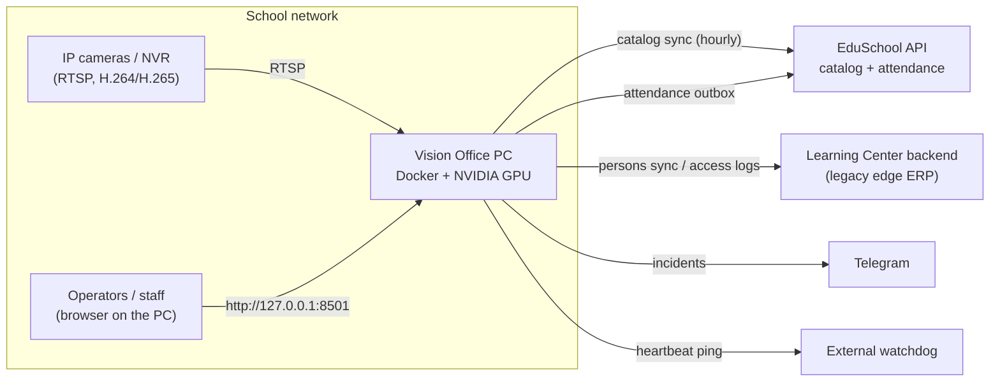
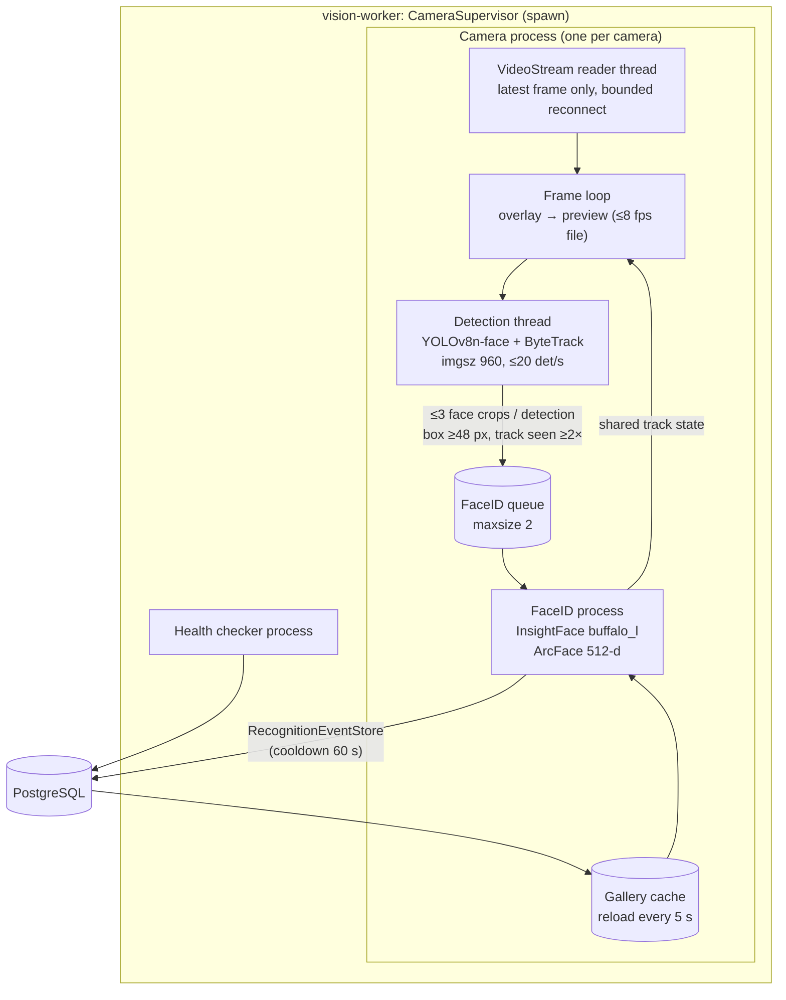
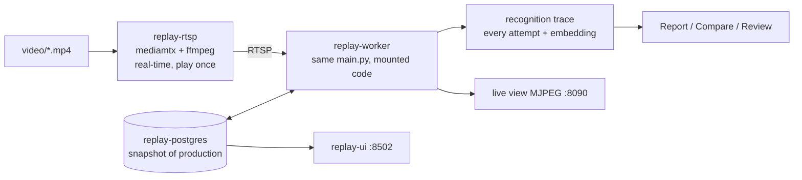

# Architecture

Vision Office turns entrance/exit camera streams into attendance records for a
school, on a single on-premise Windows PC. This document describes the moving
parts, how data flows between them and where each piece of state lives. Runbooks
for individual subsystems are indexed in [README.md](README.md).

## 1. System context

All biometric data (photos, embeddings, unknown faces) stays on the PC. Only
attendance facts for eligible identified people leave it.

## 2. Runtime services

`docker-compose.yml` runs one PostgreSQL database and independent services. Each
service can crash or restart without stopping the others.

| Service | Command | Role | Limits |
| --- | --- | --- | --- |
| `postgres` | `postgres:16-alpine` | Single source of state (volume `vision-office-postgres`). | — |
| `migrate` | `python -m database.manager` | Creates tables and applies additive migrations, then exits. | one-shot |
| `vision-worker` | `python main.py` | Camera supervisor; one process per camera; detection and recognition on GPU. | GPU (`docker-compose.gpu.yml`) |
| `edge-sync` | `python -m core.edge.sync_worker` | Legacy ERP person sync and access-log delivery. | — |
| `eduschool-sync` | `python -m core.eduschool.sync_worker` | Hourly EduSchool student/staff catalog import. | 0.5 CPU, 512 MB |
| `eduschool-photo-worker` | `python -m core.eduschool.photo_worker` | Turns EduSchool source photos into reference embeddings. | 0.5 CPU, 1 GB |
| `eduschool-turnstile` | `python -m core.eduschool.turnstile_worker` | Queues and delivers attendance to EduSchool (opt-in). | 0.25 CPU, 256 MB |
| `unknown-clusterer` | `python -m core.unknown_visitors` | Groups unknown faces into visitor cards. | 0.5 CPU, 768 MB |
| `api` | `uvicorn api.server:app` | Read-only REST API + `/monitor`, `127.0.0.1:8000`. | — |
| `ui` | `streamlit run ui/app.py` | Operator dashboard, `127.0.0.1:8501`. | — |

Ports bind to `127.0.0.1` only. GPU access is reserved for `vision-worker`;
`start_vision_office.ps1` probes the real models on the GPU (`cu124`/`cu128`
images) and falls back to CPU if the probe fails.

## 3. Camera pipeline

**Per frame.** The reader thread keeps only the newest frame (no backlog). The
frame loop hands it to the detection thread through a one-slot mailbox, draws the
latest labels (`core/overlay.py`, Cyrillic-safe, < 1 ms for 8 faces) and offers it
to the preview publisher. Nothing in this loop waits on disk, network or FaceID.

**Per track.** ByteTrack keeps a track id per face. A track is sent to FaceID when
it has been seen twice and its box is ≥ 48 px; at most three faces per detection
cycle, the least recently tried first. The crop is padded (20 % horizontally,
35 % vertically) so InsightFace can re-detect and align the face.

**Matching.** The FaceID process computes a 512-d embedding, compares it with all
active reference vectors (dot product of unit vectors) and takes the best person.
A match is accepted when:

1. similarity > threshold (EduSchool identities: `max(edge, eduschool)` = 0.50;
   legacy/local: 0.40);
2. it beats the best *different* person by ≥ `VISION_OFFICE_MIN_MATCH_MARGIN`
   (0.05 in production; 0 disables);
3. legacy/local identities win close ties against EduSchool (`_choose_best_match`).

**Retry timing.** Unknown tracks are retried every 1.5 s, searching/stabilising
tracks every 0.3 s, recognised tracks are re-checked every 5 s; tracks expire
after 10 s unseen. Queued crops older than 2 s are dropped.

**Events.** `RecognitionEventStore.record` writes one `recognition_events` row
per person (or per unknown track) per camera per cooldown window, saves the
padded crop under `data/events/<day>/`, and for unknown faces stores the
embedding in `unknown_face_observations`. Local employees also get
`attendance` rows via `HRManager`.

## 4. Identities and the gallery

| Source | Table(s) | Recognition id | Delivered to |
| --- | --- | --- | --- |
| EduSchool students/staff | `eduschool_catalog_people`, `eduschool_reference_photos` | `edu:s:<id>` / `edu:e:<id>` | EduSchool turnstile outbox (if eligible) |
| Legacy ERP (edge) | `remote_persons`, `remote_person_reference_photos` | ERP UUID | `access_log_outbox` |
| Device-only employees | `employees` (embeddings inline) | `local:<id>` | nowhere (local `attendance`) |
| Unknown faces | `unknown_face_observations`, `unknown_visitors`, `unknown_visitor_visits` | — | nowhere |

Reference photos for EduSchool people have `source`:

- `eduschool` — the catalog photo, enrolled automatically by
  `eduschool-photo-worker` (one usable face required; conflicts are rejected);
- `local` — confirmed camera frames: imported review bundles
  (`tools/import_reviewed_photos.py`) or the «Разметка» page. Up to 15 per person.

Only rows with `active = true` for active people enter the gallery. Bad
references are switched off (`active = false`), never deleted, so every fix is
reversible. See [REFERENCE_PHOTOS.md](REFERENCE_PHOTOS.md).

## 5. Delivery

All outbound calls go through durable outboxes processed by their own services,
so a slow or offline backend never affects cameras.

- **EduSchool attendance** (`core/eduschool/turnstile.py`): new recognition events
  of eligible people are queued in `eduschool_turnstile_outbox` and posted
  one by one with retry/backoff; ambiguous responses are reconciled, history is
  kept in `eduschool_delivery_attempts`. Staff eligibility is automatic (active,
  unique `employeeNo`, usable FaceID); students require `students_enabled` and a
  `studentNo`. Operators can pause a person. Historical events are never replayed.
  Per-camera EduSchool `deviceId`s live in `eduschool_turnstile.device_ids` and
  `data/camera_controls.json`.
- **Legacy ERP** (`core/edge/service.py`): `access_log_outbox` with idempotency
  keys and bounded exponential backoff; heartbeat events.
- **Telegram**: `notification_outbox`, written by the health checker.

## 6. Health and observability

- `data/runtime_status_<camera>.json` — per camera: capture FPS, frame age,
  detection/FaceID timings, device (CUDA/CPU), queue drops, gallery size.
- `data/supervisor_status.json`, `data/health_status.json` — process and component state.
- `health_incidents` — open/recovered incidents for database, disk, internet,
  ERP and each camera; Telegram alerts after the failure threshold.
- External watchdog — `health.ping_url` receives a heartbeat; missing pings raise
  the alert outside the device.
- Logs — `data/logs/vision-office.log` (rotating) and `docker compose logs`.

## 7. User interfaces

**Dashboard (`ui/app.py`, Russian).** Панель (overview), Камеры (add/pause/restart,
per-camera performance), Аналитика, Отчёты (PDF/Excel attendance), Сотрудники
(EduSchool / legacy / local / unknown catalogs), **Разметка** (staff confirm who
an unknown or almost-recognised face is), Регистрация, Отправки (delivery
journal), API.

**API (`api/server.py`).** Read-only: `/api/v1/health`, `/status`, `/employees`,
`/attendance`, `/attendance/summary`, `/recognition-events`, `/unknown-visitors`,
`/incidents`, camera previews and `/monitor`. Protected by `X-API-Key` when
`VISION_OFFICE_API_KEY` is set.

## 8. Configuration and state on disk

| Location | Content | In git |
| --- | --- | --- |
| `config/settings.yaml` | Cameras, thresholds, API credentials | no (template: `settings.example.yaml`) |
| `.env` | Secrets for Compose services | no |
| `data/camera_controls.json` | Dashboard camera overrides (take precedence over YAML) | no |
| `data/events/` | Event face crops (photos purged after 30 days, rows kept) | no |
| `data/persons/` | Reference photos | no |
| `data/previews/`, `data/runtime_status_*.json` | Live status | no |
| `data/backups/`, `data/imports/`, `data/exports/` | Dumps, transfer bundles, reports | no |
| `models/` | `yolov8n-face.pt`, `insightface/models/buffalo_l` | no |
| PostgreSQL volume | All tables | no |

## 9. Replay bench

A copy of the production pipeline for experiments, described in
[RECORDING_REPLAY.md](RECORDING_REPLAY.md):

Isolation: separate Compose project (`vision-replay`), separate volume, internal
network without Internet, no sync/turnstile/photo services, all senders disabled
by `tools/replay/make_config.py`. A recording starts only when its camera's AI is
ready, and plays once by default so statistics are not inflated.

## 10. Security and privacy

- Biometric data never leaves the PC; unknown faces are never sent anywhere.
- Credentials exist only in ignored local files; RTSP URLs are redacted in logs.
- The dashboard has no login yet and must stay bound to `127.0.0.1`. Exposing
  «Разметка» to teachers' phones requires authentication first (planned).
- Event photos are retained 30 days; unknown-visitor data 30 days
  (`unknown_visitors.retention_days`).
